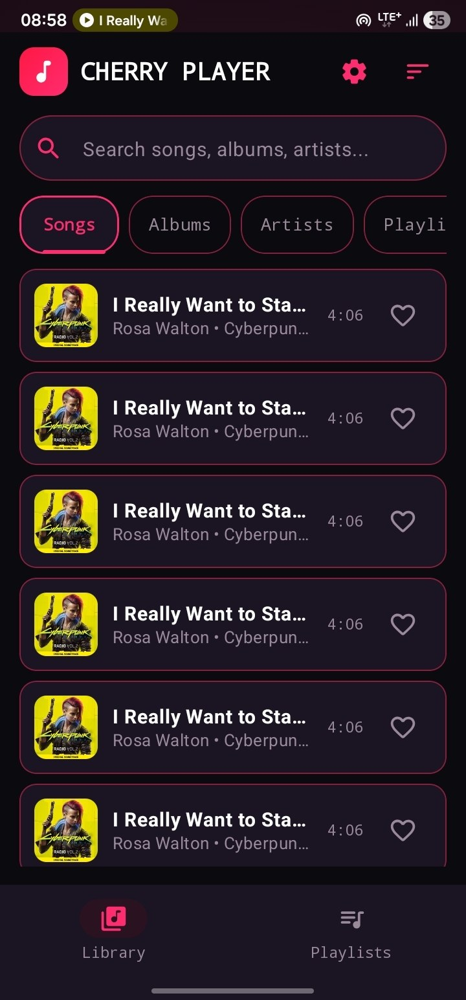
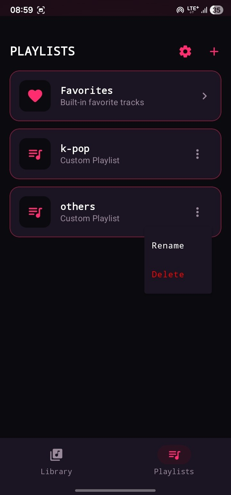
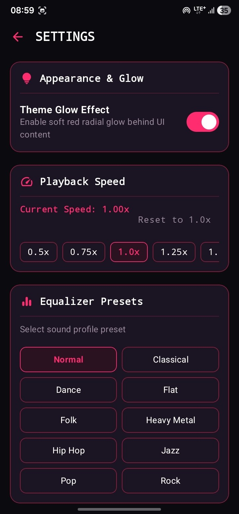

<div align="center">

# 🍒 Cherry Music Player

<p align="center">
  
</p>

> An immersive local audio player for Android featuring Jetpack Media3 ExoPlayer, rich audio format support, and glowing neon cherry playback UI. 🎵✨

</div>

---

## 📱 Overview

**Cherry Music Player** is a feature-rich, offline music player built with Jetpack Compose and Jetpack Media3 ExoPlayer. It scans local device storage for audio tracks, organizes your library by songs, artists, and albums, supports custom playlists, and provides an immersive Now Playing experience with glowing album artwork and background audio playback controls.

---

## ✨ Key Features

- 🎧 **Media3 ExoPlayer Engine**: Robust, low-latency audio playback service with background notification controls and lock screen media session support.
- 📂 **Multi-Format Local Playback**: Comprehensive support for `.mp3`, `.m4a`, `.flac`, `.wav`, `.aac`, `.ogg`, and `.opus` formats.
- 🎨 **Cherry Glow Player**: Visually stunning Now Playing screen with album art ambient glow, interactive seekbar, and repeat/shuffle modes.
- 🗂️ **Library & Playlist Management**: Instant fast search, sorting (by title, artist, date, duration), favorites, and custom playlist creation.
- 🚫 **Hide Song Feature**: Clean up ringtones, voice memos, and unwanted audio clips permanently from library views.
- 🔍 **Artist & Album Drill-Down**: Deep dive into dedicated album and artist views with sorted song tracks.

---

## 📸 Screenshots & UI Preview

| Library | Playlists | Settings |
| :---: | :---: | :---: |
|  |  |  |

---

## 🛠️ Tech Stack & Architecture

- **UI Toolkit**: [Jetpack Compose](https://developer.android.com/jetpack/compose) & [Material 3](https://m3.material.io/)
- **Audio Engine**: [Jetpack Media3 ExoPlayer](https://developer.android.com/guide/topics/media/media3) (`androidx.media3`)
- **Navigation**: Jetpack Navigation 3 (`androidx.navigation3`)
- **Dependency Injection**: [Hilt](https://dagger.dev/hilt/) (Dagger)
- **Local Storage**: Room Database & DataStore Preferences
- **Image Loading**: [Coil Compose](https://coil-kt.github.io/coil/)
- **Concurrency**: Kotlin Coroutines & `StateFlow`

---

## 📂 Project Structure

```tree
com.asta.cherrymusic/
├── data/                   # Audio metadata scan, Room database, DAOs, repositories
├── di/                     # Hilt DI modules (MediaModule, DatabaseModule)
├── service/                # MediaSessionService, playback notifications, ExoPlayer
├── ui/                     # Compose screens (Library, NowPlaying, Playlists, Settings)
├── CherryMusicApplication.kt # Application class
└── MainActivity.kt         # Entry point activity & navigation host
```

---

## 🚀 Getting Started & Build Instructions

### Prerequisites
- Android Studio Ladybug or newer
- JDK 17 or higher
- Android SDK 24+ (Target SDK 35)

### Build Steps

1. **Clone the repository**:
   ```bash
   git clone https://github.com/asta-JC/Cherry-MusicPlayer.git
   cd Cherry-MusicPlayer
   ```

2. **Open in Android Studio**:
   - Open Android Studio and select **Open**.
   - Navigate to the cloned `Cherry-MusicPlayer` directory and let Gradle sync.

3. **Build & Run**:
   - Connect an Android device or start an emulator.
   - Run the app via Android Studio or execute via terminal:
     ```bash
     ./gradlew :app:assembleDebug
     ```

4. **Run Unit Tests**:
   ```bash
   ./gradlew test
   ```

---

## 📄 License

This project is developed as part of Asta's project series. Feel free to use and adapt for personal and educational use!

---

<p align="center">
  Made with ❤️ & 🍒 by Asta
</p>
