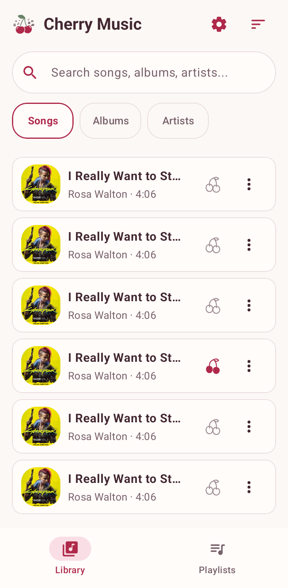
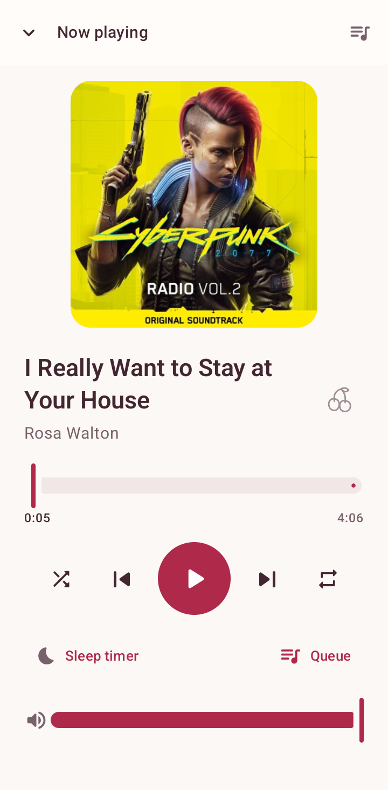
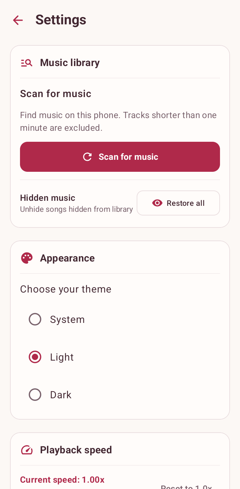

<div align="center">
  
  <h1>Cherry Music Player</h1>
  <p><strong>Your music, close at hand.</strong></p>
  <p>A local audio player for Android, with a searchable library, personal playlists, and a soft cherry interface.</p>
  <p>
    
    
    
  </p>
  <p>
    <a href="#screenshots">Screenshots</a> ·
    <a href="#features">Features</a> ·
    <a href="#getting-started">Get started</a> ·
    <a href="https://github.com/asta-JC/Cherry-MusicPlayer/issues">Feedback</a>
  </p>
</div>

---

## Overview

Cherry Music Player brings the audio already on your phone into one library. Browse songs, albums, and artists, save favorites and playlists, and keep listening in the background. Warm light and plum dark themes put the music first, with the original music-note launcher icon and shared CherryApp accents inside the app.

## Screenshots

<table>
  <tr><th width="33%">Your library</th><th width="33%">Now playing</th><th width="33%">Make it yours</th></tr>
  <tr>
    <td align="center"></td>
    <td align="center"></td>
    <td align="center"></td>
  </tr>
  <tr><td align="center">Find a song. Save a favorite.</td><td align="center">More room for the music.</td><td align="center">Choose how it feels.</td></tr>
</table>

All three screenshots were captured in Light mode from v1.1 on a physical Samsung Galaxy S22 Ultra (SM-S908N). The player and library show local music from the device; songs are not bundled with the app. System status and navigation bars are omitted from the gallery captures.

## Features

- **A local music library:** scan device audio, search by song, artist, or album, and sort by title, artist, or date added.
- **Favorites and playlists:** mark favorites with a cherry, create and rename playlists, and add or remove tracks.
- **A focused player:** still album artwork, seek-on-release controls, a playback queue, shuffle, and repeat modes.
- **Background listening:** Media3 playback with system notification and media-session controls.
- **Personal playback:** playback speed, player volume, and a sleep timer that pauses the music.
- **A quieter interface:** saved System, Light, and Dark appearance choices, plus hiding unwanted songs and restoring them from Settings.

## Compatibility

| Area | Behavior |
| :--- | :--- |
| Android | Android 7.0 / API 24 or newer; requests audio access to find local music |
| Common audio | MP3, M4A/AAC, FLAC, WAV, OGG, and Opus; actual decoding depends on the file and device codecs |
| Library scanning | Includes files marked as music by Android and at least 60 seconds long |
| Artwork | Uses local album artwork when available, with a cherry fallback for missing or unreadable covers |
| Storage | Favorites, playlists, hidden tracks, and appearance preferences stay in the app's local database/preferences |

This is a local-file player; streaming and music downloads are not included. Equalizer preset selection is currently a saved preference and does not apply audio effects. The sleep timer belongs to the running app session.

## Getting started

### Requirements

- A physical Android device running Android 7.0 / API 24 or newer.
- Android Studio compatible with the pinned Android Gradle Plugin and Gradle versions.
- Android SDK 37 and JDK 25, as selected by the Gradle daemon toolchain configuration. The app targets Java 11 bytecode.

### Build and run

```bash
git clone https://github.com/asta-JC/Cherry-MusicPlayer.git
cd Cherry-MusicPlayer
./gradlew :app:assembleDebug
```

The debug APK is generated at `app/build/outputs/apk/debug/app-debug.apk`. Connect your physical phone with USB debugging enabled, then install and open it:

```bash
adb devices -l
adb -s YOUR_DEVICE_SERIAL install -r app/build/outputs/apk/debug/app-debug.apk
adb -s YOUR_DEVICE_SERIAL shell am start -n com.asta.cherrymusicplayer/.MainActivity
```

Allow music access when prompted. Scan for music from Settings if newly added files do not appear.

### Tests

```bash
./gradlew :app:testDebugUnitTest :app:lintDebug
ANDROID_SERIAL=YOUR_DEVICE_SERIAL ./gradlew :app:connectedDebugAndroidTest
```

The focused tests cover seek interactions, progress bounds, theme defaults, and persisted appearance choices. Instrumented tests run on the connected physical device.

## Built with

| Layer | Technology |
| :--- | :--- |
| Interface | Kotlin, Jetpack Compose, Material 3 |
| Navigation | Jetpack Navigation 3 |
| Audio | Media3 ExoPlayer and MediaSessionService |
| Local data | Room and DataStore Preferences |
| Images | Coil |
| State and dependencies | Coroutines, StateFlow, Hilt |

<details>
<summary>Source map</summary>

```text
app/src/main/java/com/asta/cherrymusicplayer/
├── data/       # Music scanning, database, playlists, preferences
├── di/         # Hilt dependency modules
├── service/    # Background audio and media session
└── ui/         # Library, player, playlists, settings, shared theme
```

</details>

## What's new in 1.1

- Softer light and dark themes with the full CherryApp header mark.
- Clearer library actions, artwork fallbacks, and playlist controls.
- Shorter transitions, isolated progress updates, and seeking on release.
- The original music-note launcher icon is preserved.

## Feedback

Found a playback or interface issue? [Open an issue](https://github.com/asta-JC/Cherry-MusicPlayer/issues) with the Android version, device model, audio format, and steps to reproduce it. Use a small, non-sensitive sample if a file is needed.

## License & credits

This project is developed as part of Asta's project series. Feel free to use and adapt for personal and educational use!

The repository does not currently include a standalone license file. Third-party libraries retain their own licenses.

---

<p align="center">
  <strong>Made with ❤️ &amp; 🍒 by Asta</strong><br />
  <sub>Part of the CherryApp family.</sub>
</p>
